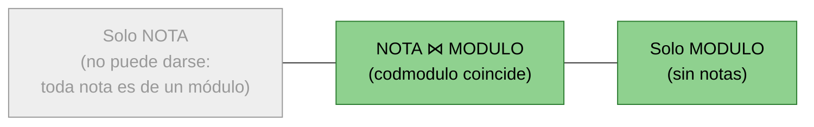
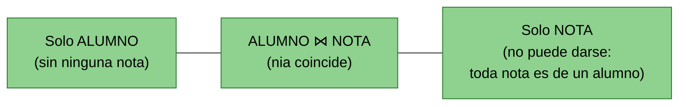
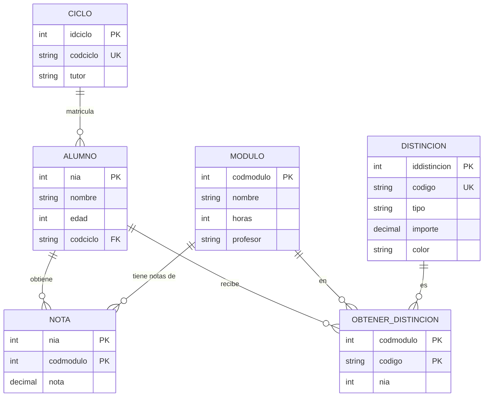

# El lenguaje SQL: Manipulación

## Objetivos

| # | Objetivo |
|---|---|
| 1 | Presentar la sintaxis del lenguaje SQL (solo del Lenguaje de Manipulación). |
| 2 | Ver algunos ejemplos sencillos para clarificar la semántica del SQL. |
| 3 | Presentar la base de datos ACADEMIA, con un conjunto de datos de ejemplo ya poblado. |
| 4 | Realizar de menor a mayor complejidad consultas SQL sobre dicha base de datos, mostrando en cada caso el resultado real que producen. |

!!! note "Sobre los datos de este documento"
    Todos los ejemplos de este tema se ejecutan sobre la misma base de datos ACADEMIA, que modela un centro de FP de la familia de Informática (ciclos, alumnado, módulos, notas y distinciones académicas), poblada con un pequeño conjunto de datos fijo (ver la sección "Base de datos de referencia: ACADEMIA" al final del documento).

    Esto permite comprobar a mano el resultado de cada consulta, en lugar de limitarse a leer el enunciado y la sintaxis. Se recomienda, antes de mirar el resultado dado, intentar calcularlo mentalmente sobre las tablas de datos.

---

## Consultas: instrucción SELECT

!!! tip "Idea clave"
    `SELECT` es la única instrucción de consulta del Lenguaje de Manipulación de Datos (DML) en SQL. Sirve para **recuperar información** de una o varias tablas.

    Su estructura sigue siempre el mismo orden lógico de cláusulas (aunque no todas sean obligatorias): qué columnas quiero (`select`), de qué tabla(s) (`from`), con qué condición (`where`), cómo agrupar (`group by`), con qué condición sobre los grupos (`having`) y en qué orden mostrar el resultado (`order by`).

    Para el examen conviene memorizar este orden de escritura y también el orden real de evaluación (`from` → `where` → `group by` → `having` → `select` → `order by`).

```sql
select [all | distinct] , lista_item_seleccionado | *
from , lista_referencia_tabla
[where expresión_condicional]
[group by , lista_referencia_col]
[having expresión_condicional]
[order by , lista_referencia_col]
```

- **, lista_item_seleccionado**: información a obtener de la base de datos.
- **from , lista_referencia_tabla**: especifica de qué tablas se obtiene la información buscada.
- **where expresión_condicional**: expresa una condición que deben cumplir las filas de la consulta resultante.
- **group by , lista_referencia_col**: permite formar consultas agrupadas para extraer información global sobre los grupos formados.
- **having expresión_condicional**: condición sobre los grupos formados.
- **order by , lista_referencia_col**: ordena por una o varias columnas.

### Condiciones en consultas simples

!!! tip "Idea clave"
    Esta es la forma más básica de consulta, sin agrupación.

    Lo importante aquí son los **predicados** que se pueden usar en la cláusula `where`: comparación clásica, `like` (patrones de texto), `between` (rangos), `in` (pertenencia a un conjunto) e `is null` (comprobación de nulos, que **no** se puede hacer con `= null`). Son la base de casi todas las consultas del tema.

```sql
select [all | distinct] , lista_ítem_seleccionado | *
from tabla
[where expresión_condicional]
[order by , lista_referencia_col]
```

- **all**: Permite la aparición de filas idénticas (valor por defecto).
- **distinct**: No permite la aparición de filas idénticas.
- La *expresión_condicional* está formada por un conjunto de predicados combinados con las conectivas lógicas `and`, `or` y `not`. Los predicados utilizados permiten comparar columnas:
  - predicados de comparación: `=`, `<>`, `>`, `<`, `>=`, `<=`.
  - predicado `like`: permite comparar una tira de caracteres con un patrón.
  - predicado `between`: permite comprobar si un escalar está en un rango.
  - predicado `in`: permite comprobar si el valor está dentro de un conjunto.
  - predicado `is null`: permite comprobar si el valor es nulo.

**EJEMPLO:** Obtener el nombre y la edad de todos los alumnos.

```sql
SELECT nombre, edad FROM Alumno;
```

**Resultado:** las 10 filas de la tabla ALUMNO (columnas `nombre`, `edad`), incluyendo `Jorge Salas` con edad `NULL`.

**EJEMPLO:** Obtener el nombre y las horas de todos los módulos de 100 horas.

```sql
SELECT nombre, horas FROM Modulo
WHERE horas = 100;
```

**Resultado:**

| nombre | horas |
|---|---|
| Itinerario Personal para la Empleabilidad I | 100 |
| Entornos de Desarrollo | 100 |
| Lenguajes de Marcas y Sistemas de Gestión de la Información | 100 |

**EJEMPLO:** Obtener el nombre de los alumnos cuya edad está entre 20 y 30 años.

```sql
SELECT nombre FROM Alumno
WHERE edad BETWEEN 20 AND 30;
```

**Resultado:** Antonio Ruiz, Javier Torres, Carlos Ferrer, Manuel Ortega, Luis Campos, Sergio Molina, Roberto Díaz, Pablo Núñez — es decir, todo el alumnado de los ciclos de grado superior (DAM, DAW y ASIR). *(Diego Vidal queda fuera por tener 17 años, propios de un ciclo de grado medio como SMR; Jorge Salas queda fuera porque su edad es `NULL` y ninguna comparación con `NULL` da cierto.)*

> (\*) El predicado `between` es equivalente a una condición con comparaciones de la siguiente forma:
> `exp between exp1 and exp2 ≡ (exp >= exp1) and (exp <= exp2)`

**EJEMPLO:** Obtener el código de los módulos cuyo nombre tenga por segunda letra una "T", o cuyo profesor incluya dos o más letras "A".

```sql
SELECT codmodulo FROM Modulo
WHERE nombre LIKE '_T%' OR profesor LIKE '%A%A%';
```

**Resultado:** `1` (nombre `Itinerario Personal para la Empleabilidad I`, 2ª letra "t"), `3` (profesor `Ana Salas`), `5` (profesor `Javier Aranda`) y `6` (profesor `Ana Barranco`). Es decir: **1, 3, 5, 6**.

**EJEMPLO:** Obtener el nombre de los módulos cuyas horas sean 100, 166 o 266.

```sql
SELECT nombre FROM Modulo
WHERE horas IN ( 100, 166, 266 );
```

**Resultado:** en nuestros datos, esos son precisamente los tres valores de `horas` que existen, así que el resultado son los seis módulos completos.

> (\*) También el predicado `in` es derivado y la expresión equivalente es:
> `exp in (exp1, exp2, …, expn) ≡ (exp=exp1) or (exp=exp2) or…or (exp=expn)`

**EJEMPLO:** Obtener todos los datos de aquellos alumnos de los que se desconocía su edad.

```sql
SELECT * FROM Alumno
WHERE edad IS NULL;
```

**Resultado:** la fila completa de `Jorge Salas` (nia 10, SMR, edad `NULL`).

### Comparación de valores nulos

!!! tip "Idea clave"
    Es uno de los puntos donde más se falla en los exámenes. `NULL` no es un valor, sino la **ausencia** de valor, por lo que ninguna comparación (`=`, `<`, `>`...) con `NULL` da verdadero ni falso: da **indefinido**, y las filas con resultado indefinido se descartan de la selección.

    La única forma correcta de comprobar nulos es con `IS NULL` / `IS NOT NULL`; usar `= null` es un error de sintaxis.

Las comparaciones entre cualquier valor y `NULL` resultan en *indefinido*. Por ejemplo, en nuestros datos:

```sql
SELECT nombre FROM Alumno
WHERE edad > 25;
```

Esta consulta **no** incluye a Jorge Salas, aunque no sepamos si su edad real es mayor o menor de 25: la comparación `NULL > 25` es indefinida, así que su fila se descarta.

**Ejemplo de consulta incorrecta (error de sintaxis):**

```sql
SELECT nombre FROM Alumno
WHERE edad = NULL;
```

Esta consulta no da ningún error, pero tampoco hace lo que parece: nunca devuelve ninguna fila (ni siquiera la de Jorge Salas), porque `= NULL` siempre es indefinido. La forma correcta es `WHERE edad IS NULL`.

### Más ejemplos de comparaciones

!!! tip "Idea clave"
    Las columnas numéricas admiten operaciones aritméticas directamente en el `select` o en el `where` (por ejemplo, para hacer conversiones de unidades).

    El predicado `LIKE` compara cadenas con un patrón usando comodines: `_` sustituye un único carácter y `%` sustituye cualquier secuencia (incluida la vacía). Si el texto buscado contiene literalmente un `%` o un `_`, hay que "escaparlo" con la cláusula `ESCAPE`.

Uso de operadores aritméticos: `+` (suma), `-` (diferencia), `*` (producto), `/` (división), etc.

**EJEMPLO:** Obtener el tipo y el importe (en euros) revalorizado un 10%, de aquellas distinciones cuyo importe actual supere los 100 euros.

```sql
SELECT tipo, importe * 1.1 FROM Distincion
WHERE importe > 100;
```

**Resultado:** de las cuatro distinciones, solo la Matrícula de Honor (150 €) y el Premio al Esfuerzo (120 €) superan los 100 €; la Mención Especial (90 €) y la Beca de Excelencia (60 €) quedan excluidas.

| tipo | importe * 1.1 |
|---|---|
| Matrícula de Honor | 165 |
| Premio al Esfuerzo | 132 |

**Uso de LIKE / ESCAPE**

!!! note "Ejemplo puramente sintáctico"
    Ninguno de los valores de nuestra base de datos ACADEMIA contiene literalmente el carácter `%`, así que este ejemplo concreto no se corresponde con los datos anteriores: su único objetivo es mostrar la sintaxis de `ESCAPE` sobre una tabla genérica.

**EJEMPLO:** Obtener el nombre de los empleados cuyo puesto contenga literalmente la cadena "100%" (por ejemplo, un puesto llamado "Comercial 100%").

```sql
SELECT nombre FROM Empleado
WHERE puesto LIKE '%100\%%' ESCAPE '\';
```

Aquí `\` se declara como carácter de escape, de modo que `\%` deja de interpretarse como comodín y pasa a buscarse como el carácter `%` literal.

### Ordenación y limitación de resultados (ORDER BY / LIMIT)

!!! tip "Idea clave"
    `ORDER BY` ordena el resultado por una o varias columnas: `ASC` (ascendente, por defecto) o `DESC` (descendente). Se puede ordenar por varias columnas a la vez, separadas por comas; la segunda columna solo desempata a la primera.

    `LIMIT n` restringe el resultado a las primeras `n` filas (tras aplicar el `ORDER BY`, si lo hay). `LIMIT n OFFSET m` descarta las `m` primeras filas y devuelve como máximo `n` a partir de ahí.

    En MySQL/MariaDB, los valores `NULL` se consideran "los más pequeños": aparecen primero en `ASC` y últimos en `DESC`.

**EJEMPLO ORDER BY:** Obtener el nombre y la edad de los alumnos, de menor a mayor edad.

```sql
SELECT nombre, edad FROM Alumno
ORDER BY edad ASC;
```

**Resultado:** 10 filas. Jorge Salas (edad `NULL`) aparece el primero, seguido del resto de menor a mayor edad: Diego Vidal (17), Roberto Díaz (22), Luis Campos (24), Carlos Ferrer (26), Javier Torres (27), Pablo Núñez y Antonio Ruiz (28), y por último Manuel Ortega y Sergio Molina (29).

**EJEMPLO ORDER BY DESC + LIMIT:** Obtener el tipo y el importe de las dos distinciones de mayor importe.

```sql
SELECT tipo, importe FROM Distincion
ORDER BY importe DESC
LIMIT 2;
```

**Resultado:**

| tipo | importe |
|---|---|
| Matrícula de Honor | 150.00 |
| Premio al Esfuerzo | 120.00 |

**EJEMPLO ORDER BY con varias columnas + LIMIT/OFFSET:** Obtener el nombre y el ciclo de los alumnos, ordenados por ciclo y, dentro de cada ciclo, por nombre; mostrar solo de la tercera a la quinta fila.

```sql
SELECT nombre, codciclo FROM Alumno
ORDER BY codciclo, nombre
LIMIT 3 OFFSET 2;
```

**Resultado:** ordenando por ciclo (ASIR, DAM, DAW, SMR) y luego por nombre, las dos primeras filas son de ASIR (Pablo Núñez, Roberto Díaz); saltando esas dos (`OFFSET 2`), las 3 siguientes (`LIMIT 3`) son los alumnos de DAM:

| nombre | codciclo |
|---|---|
| Antonio Ruiz | DAM |
| Carlos Ferrer | DAM |
| Javier Torres | DAM |

---

## Consultas de valores agregados

!!! tip "Idea clave"
    Las funciones agregadas (`avg`, `max`, `min`, `sum`, `count`) resumen un conjunto de filas en **un único valor** (por columna o por grupo).

    Puntos que suelen preguntarse: no se pueden anidar, `sum`/`avg` exigen argumentos numéricos, los valores nulos se descartan antes de calcular, y si no hay filas, `count` devuelve 0 mientras que el resto devuelven `NULL`.

La sintaxis de una referencia a una función agregada es la siguiente:

```
{ avg | max | min | sum | count } ( [all | distinct] expresión_escalar ) | count(*)
```

- Las funciones agregadas no se pueden anidar.
- Para las funciones `sum` y `avg` los argumentos deben ser numéricos.
- `distinct` indica que los valores redundantes sean eliminados antes de que se realice el cálculo correspondiente.
- La función especial `count(*)`, en la que no está permitido incluir `distinct` ni `all`, da como resultado el cardinal del conjunto de filas de la selección.
- Los cálculos se realizan después de la selección y aplicar las condiciones.
- Los valores nulos son eliminados antes de realizar los cálculos (incl. `count`).
- Si el número de filas de la selección es 0, la función `count` devuelve el valor 0 y las otras funciones el valor nulo.

### Funciones agregadas en consultas no agrupadas

!!! tip "Idea clave"
    Cuando una consulta **no** tiene `group by` pero incluye una función agregada, toda la tabla (tras aplicar el `where`) se trata como un único grupo.

    Por eso en el `select` solo pueden aparecer funciones agregadas o literales: mezclar una columna "suelta" (como `nombre`) con una función agregada (como `AVG(edad)`) no tiene sentido, porque la función devuelve un solo valor y la columna devolvería muchos.

**EJEMPLO:**

```sql
SELECT 'Núm. de alumnos =', COUNT(*), 'Media Edad =', AVG(edad)
FROM Alumno
WHERE codciclo = 'DAM';
```

**Resultado:** `Núm. de alumnos = 4`, `Media Edad = 27,5` *(DAM tiene 4 alumnos: Antonio 28, Javier 27, Carlos 26 y Manuel 29; media = (28+27+26+29)/4 = 27,5).*

En consultas no agrupadas, la selección solo podrá incluir referencias a **funciones agregadas** o **literales** ya que las funciones van a devolver un único valor.

**EJEMPLO INCORRECTO:**

```sql
SELECT nombre, AVG(edad)
FROM Alumno
WHERE codciclo = 'DAW';
```

---

## Consultas simples sobre varias tablas

!!! tip "Idea clave"
    Para combinar datos de varias tablas, la forma más sencilla es listarlas todas en el `from` (separadas por comas), lo que genera internamente un **producto cartesiano**, y luego filtrar con el `where` las combinaciones de filas que tienen sentido.

    Cuando una columna existe en más de una tabla (por ejemplo `nia`), hay que cualificarla con el nombre de la tabla (`tabla.columna`) para evitar ambigüedad.

Cuando la información que se desea obtener de la base de datos se encuentra almacenada en más de una tabla se hace indispensable el declarar una consulta que manipule estas tablas.

**EJEMPLO:** Obtener pares de nombre de alumno y nota, para notas superiores a 8.

```sql
select Alumno.nombre, Nota.nota
from Alumno, Nota
where Alumno.nia = Nota.nia AND Nota.nota > 8;
```

!!! note "Un matiz importante"
    Aquí la columna `nia` existe en **ambas** tablas (`Alumno` y `Nota`), así que su referencia en el `where` es ambigua y es obligatorio cualificarla con el nombre de la tabla, tal y como se ha hecho.

**Resultado** (4 filas):

| nombre | nota |
|---|---|
| Diego Vidal | 9,5 |
| Roberto Díaz | 9,0 |
| Diego Vidal | 9,0 |
| Diego Vidal | 9,5 |

En esta expresión es obligatorio que la referencia a la columna *nia* de *Alumno* y *Nota* sea calificada con el nombre de la tabla, si es ambigua. En general,

```
[tabla].columna
```

### Uso de claves ajenas en consultas de varias tablas

!!! tip "Idea clave"
    En la práctica, casi todas las consultas de varias tablas igualan la **clave ajena** de una tabla con la **clave primaria** de la tabla referenciada (por ejemplo `A.codciclo = C.codciclo`). Es lo que en álgebra relacional sería una reunión (join) natural.

    Si se olvida esta condición, el resultado es el producto cartesiano completo, con muchas más filas de las deseadas.

- La consulta de varias tablas corresponde al producto cartesiano.
- Si no se eligen bien las condiciones el número de filas resultantes puede ser muy grande.
- Si existen claves ajenas, lo más normal es una igualdad entre la clave ajena y los atributos correspondientes de la tabla a la que se hace referencia.

**EJEMPLO:** Obtener los nombres de los alumnos matriculados en el ciclo cuyo tutor sea 'Álvaro Pino'.

```sql
SELECT A.nombre FROM Alumno A, Ciclo C
WHERE A.codciclo = C.codciclo AND C.tutor = 'Álvaro Pino';
```

**Resultado:** Álvaro Pino es el tutor del ciclo SMR → **Diego Vidal** y **Jorge Salas**.

**EJEMPLO:** Obtener pares nombre de alumno, código de módulo, de tal forma que el módulo que cursen supere las 150 horas.

```sql
SELECT A.nombre, N.codmodulo
FROM Alumno A, Modulo M, Nota N
WHERE A.nia = N.nia AND M.codmodulo = N.codmodulo AND M.horas > 150;
```

---

## Consultas complejas: agrupación

!!! tip "Idea clave"
    `GROUP BY` divide las filas de la tabla en **grupos** que comparten el mismo valor en la(s) columna(s) indicadas, y las funciones agregadas pasan a calcular un resultado **por cada grupo**, no sobre toda la tabla.

    Es la herramienta para responder preguntas del tipo "para cada X, calcula...".

**EJEMPLO:** Obtener el código de **cada** ciclo y la edad media de los alumnos de dicho ciclo:

```sql
SELECT codciclo, AVG(edad) FROM Alumno
GROUP BY codciclo;
```

Usando la tabla ALUMNO del principio del documento, cada fila se agrupa por `codciclo` y se calcula la media de `edad` dentro de cada grupo (los valores `NULL`, como el de Jorge Salas, se ignoran en el cálculo):

| codciclo | AVG(edad) |
|---|---|
| DAM | 27,5 |
| DAW | 26,5 |
| ASIR | 25 |
| SMR | 17 |

### Relación selección-agrupamiento

!!! tip "Idea clave"
    La regla de oro de las consultas agrupadas (muy preguntada en examen): en el `select` de una consulta con `group by` **solo** pueden aparecer las columnas de agrupación, funciones agregadas o literales.

    Nunca una columna "suelta" que no esté en el `group by`, porque no tendría un valor único por grupo.

Un grupo se puede entender como un conjunto de filas con el mismo valor para el conjunto de columnas por las que se agrupa (las incluidas en la cláusula `group by`).

Las funciones agregadas en las consultas agrupadas funcionan de forma diferente que en las consultas normales, devolviendo un valor por cada grupo formado.

De una consulta agrupada solo se puede realizar una selección que devuelve un valor, simple o compuesto, por cada grupo formado en la consulta.

**EJEMPLO INCORRECTO:**

```sql
SELECT codciclo, nombre, AVG(edad) FROM Alumno
GROUP BY codciclo;
```

*(No es válida: el grupo "DAM" tiene 4 nombres distintos — Antonio, Javier, Carlos y Manuel — así que `nombre` no tiene un único valor por grupo.)*

La regla sintáctica que aplican los sistemas relacionales para asegurar el buen funcionamiento de las consultas agrupadas es la siguiente:

> "en la selección de una consulta agrupada, solo pueden aparecer referencias a columnas por las cuales se agrupa, referencias a funciones agregadas o literales".

### GROUP y WHERE

!!! tip "Idea clave"
    El `where` de una consulta agrupada se aplica **antes** de formar los grupos, es decir, filtra filas individuales, no grupos.

    Por eso en el `where` nunca puede aparecer una función agregada (todavía no se han calculado los grupos en ese momento).

Si se incluye la cláusula `where` la aplicación de esta cláusula se produce previamente a la agrupación.

```sql
SELECT codciclo, AVG(edad) FROM Alumno
WHERE edad > 25
GROUP BY codciclo;
```

**Resultado:** primero se descartan las filas con `edad <= 25` o `NULL` (Luis Campos, 24; Roberto Díaz, 22; Diego Vidal, 17; y Jorge Salas, por ser `NULL`) y después se agrupa:

| codciclo | AVG(edad) |
|---|---|
| DAM | 27,5 |
| DAW | 29 |
| ASIR | 28 |

Nótese que el ciclo SMR desaparece por completo del resultado: al quedarse sin ninguna fila tras el `WHERE` (sus dos alumnos son menores de 25 años o de edad `NULL`), no llega a formar grupo.

### GROUP, WHERE y HAVING

!!! tip "Idea clave"
    `HAVING` es al grupo lo que `WHERE` es a la fila: filtra grupos ya formados, normalmente en base al resultado de una función agregada (por ejemplo, "ciclos con más de 3 alumnos").

    Es clave recordar el orden real de evaluación: primero `WHERE` (filas), después `GROUP BY` (se forman los grupos y se calculan los agregados), y por último `HAVING` (se filtran los grupos).

La cláusula `HAVING`, que solo puede ir en consultas agrupadas, es similar a `WHERE` pero el orden es el siguiente:

1. Condición `WHERE` (se usa para las filas)
2. Agrupamiento y cálculo de valores agregados
3. Condición `HAVING` (se usa para los grupos)

En la cláusula `HAVING`, solo podrán aparecer directamente referencias a columnas por las cuales se agrupan o a funciones agregadas.

**EJEMPLO:** Obtener el código de **cada** ciclo y la edad media de sus alumnos con más de 25 años, de aquellos ciclos con más de 3 alumnos mayores de 25 años.

```sql
SELECT codciclo, AVG(edad) FROM Alumno
WHERE edad > 25
GROUP BY codciclo
HAVING COUNT(nia) > 3;
```

**Resultado:** tras el `WHERE edad > 25`, el único ciclo con más de 3 alumnos es DAM (sus 4 alumnos tienen todos más de 25 años) → (**DAM**, **27,5**).

---

## Combinaciones de tablas

!!! tip "Idea clave"
    Además del `from` con varias tablas y las subconsultas ya vistas, SQL ofrece operadores específicos para combinar tablas.

    Las **combinaciones conjuntistas** se basan en teoría de conjuntos (unión, diferencia, intersección) y las **concatenaciones** se basan en el operador de reunión del Álgebra Relacional (producto cartesiano y los distintos tipos de `JOIN`).

Existen otras formas de combinar varias tablas en consultas y todas ellas, junto con las ya vistas, dan lugar a una "expresión de tabla".

Existen, en definitiva, varias formas de combinar dos tablas en el lenguaje SQL:

- Incluir varias tablas en la cláusula `from`.
- Uso de subconsultas en las condiciones de las cláusulas `where` o `having`.
- **Combinaciones conjuntistas de tablas**: utilizan operadores de la teoría de conjuntos para combinar las tablas.
- **Concatenaciones de tablas**: combinan dos tablas utilizando diferentes variantes del operador concatenación del Álgebra Relacional.

### Combinaciones conjuntistas de tablas

!!! tip "Idea clave"
    `UNION`, `EXCEPT` e `INTERSECT` combinan los resultados de dos consultas fila a fila, como si fueran conjuntos. Para poder usarlos, ambas consultas deben tener **esquemas compatibles** (mismo número de columnas y tipos compatibles).

    Por defecto eliminan duplicados; con `UNION ALL` se conservan.

Corresponden a los operadores *unión*, *diferencia* e *intersección* del Álgebra Relacional.

- `UNION`
- `EXCEPT`
- `INTERSECT`

Permiten combinar tablas que tengan esquemas **compatibles**.

**UNION**

```
expresión_tabla union [all] término_tabla
```

Realiza la unión de las filas de las tablas provenientes de las dos expresiones. Se permitirán o no duplicados según se incluya o no la opción `all`.

**EJEMPLO:** Obtener el nombre de los alumnos de 'DAM' y de 'DAW'.

```sql
(SELECT nombre FROM Alumno WHERE codciclo = 'DAM')
UNION
(SELECT nombre FROM Alumno WHERE codciclo = 'DAW')
```

**Resultado:** Antonio Ruiz, Javier Torres, Carlos Ferrer, Manuel Ortega (DAM) + Luis Campos, Sergio Molina (DAW) → 6 nombres en total.

**EXCEPT**

```
expresión_tabla except término_tabla
```

Realiza la diferencia de conjuntos: filas de la primera consulta que **no** aparecen en la segunda.

!!! note "Disponibilidad en MySQL"
    `EXCEPT` e `INTERSECT` solo están disponibles a partir de MySQL 8.0.31 (versiones anteriores no los soportan). En MariaDB están disponibles desde la versión 10.3.

**EJEMPLO:** Obtener el nombre de los alumnos de 'DAM' que no tengan nia 3 o 4.

```sql
(SELECT nombre FROM Alumno WHERE codciclo = 'DAM')
EXCEPT
(SELECT nombre FROM Alumno WHERE nia IN (3,4))
```

**INTERSECT**

```
expresión_tabla intersect término_tabla
```

Realiza la intersección de conjuntos: solo las filas que aparecen en **ambas** consultas.

**EJEMPLO:** Obtener el nombre de los alumnos de 'DAM' que tengan nia 1 o 2.

```sql
(SELECT nombre FROM Alumno WHERE codciclo = 'DAM')
INTERSECT
(SELECT nombre FROM Alumno WHERE nia IN (1, 2))
```

**Resultado:** el resultado complementario del ejemplo anterior → **Antonio Ruiz** y **Javier Torres**, los dos únicos alumnos de DAM con nia.

### Concatenaciones de tablas

!!! tip "Idea clave"
    Son las distintas variantes del `JOIN` conocidas de bases de datos: `INNER JOIN` (solo filas que casan en ambas tablas, equivalente a lo visto con `from` + `where`), `LEFT`/`RIGHT`/`FULL OUTER JOIN` (conservan también las filas sin pareja, rellenando con `NULL`) y la concatenación unión (mucho menos usada en la práctica).

    En MySQL, lo habitual es trabajar con `INNER JOIN` y `LEFT JOIN`. `RIGHT JOIN` se usa menos (basta con cambiar el orden de las tablas y usar `LEFT JOIN`), y `FULL OUTER JOIN` **no existe** como tal en MySQL: hay que simularlo.

Corresponden a variantes del operador concatenación del Álgebra Relacional.

- Producto cartesiano (`cross join`)
- Concatenación interna:

```
referencia_tabla [natural] [inner] join referencia_tabla
[on expresión_condicional | using (, lista_columna) ]
```

- Concatenación externa:

```
referencia_tabla [natural]
{left [outer]  |
 right [outer] |
 full [outer]  } JOIN referencia_tabla
[on expresión_condicional | using (, lista_columna) ]
```

En todos los ejemplos siguientes se usa el mismo diagrama de apoyo: dos tablas relacionadas mediante una clave ajena real (no calculada), con tres zonas posibles en el resultado — filas solo de la tabla izquierda, filas que casan en ambas y filas solo de la tabla derecha. Cada tipo de `JOIN` se distingue por qué zonas incluye (resaltadas en verde) y cuáles descarta (en gris).

#### INNER JOIN

!!! tip "Idea clave"
    `INNER JOIN` es el que ya conocíamos por el `from` con varias tablas y una condición en el `where`: solo aparecen las filas que **casan** en ambas tablas según la condición `on`. Las filas sin pareja, de cualquiera de los dos lados, se descartan.


**EJEMPLO:** Obtener el nombre del alumno, el módulo y la nota, solo para los alumnos que tienen alguna nota registrada.

```sql
SELECT A.nombre, N.codmodulo, N.nota
FROM Alumno A INNER JOIN Nota N ON A.nia = N.nia;
```

**Resultado:** solo aparecen los 5 alumnos con alguna nota registrada (Antonio Ruiz, Javier Torres, Luis Campos, Roberto Díaz y Diego Vidal), cada uno con sus 4 notas → **20 filas**. Es exactamente el mismo resultado que se obtendría con `FROM Alumno A, Nota N WHERE A.nia = N.nia` — el `INNER JOIN` es solo una forma alternativa (y más explícita) de escribir la misma reunión.

#### LEFT JOIN

!!! tip "Idea clave"
    `LEFT JOIN` conserva **todas** las filas de la tabla de la izquierda, tengan o no pareja en la tabla de la derecha. Cuando no hay pareja, las columnas de la tabla derecha aparecen a `NULL`.


**EJEMPLO:** Obtener el nombre de todos los alumnos y, si tienen alguna nota registrada, el módulo y la nota (y `NULL` si no tienen ninguna):

```sql
SELECT A.nombre, N.codmodulo, N.nota
FROM Alumno A LEFT JOIN Nota N ON A.nia = N.nia;
```

**Resultado:** a diferencia de un `INNER JOIN`, aquí sí aparecen los 5 alumnos sin ninguna nota (Carlos Ferrer, Manuel Ortega, Sergio Molina, Pablo Núñez y Jorge Salas), con `codmodulo` y `nota` a `NULL`. Junto con las 20 filas de los 5 alumnos con notas, el resultado tiene 20 + 5 = **25 filas** en total.

#### RIGHT JOIN

!!! tip "Idea clave"
    `RIGHT JOIN` es el espejo del `LEFT JOIN`: conserva **todas** las filas de la tabla de la derecha, tengan o no pareja en la izquierda. En MySQL apenas se usa, porque cualquier `RIGHT JOIN` se puede reescribir como un `LEFT JOIN` sin más que intercambiar el orden de las tablas.



**EJEMPLO:** Obtener el código y nombre de todos los módulos y, si tienen alguna nota registrada, el nia del alumno y la nota (y `NULL` si el módulo no tiene ninguna):

```sql
SELECT M.codmodulo, M.nombre, N.nia, N.nota
FROM Nota N RIGHT JOIN Modulo M ON N.codmodulo = M.codmodulo;
```

**Resultado:** aparecen los 6 módulos; los módulos 1 y 5, que no tienen ninguna nota registrada, aparecen con `N.nia` y `N.nota` a `NULL`. Los otros 4 módulos (2, 3, 4 y 6) aparecen 5 veces cada uno, una por cada alumno con nota → 2 + 20 = **22 filas** en total.

!!! note "Equivalencia con LEFT JOIN"
    Esta misma consulta se podría escribir, de forma equivalente, intercambiando las tablas y usando `LEFT JOIN`: `SELECT M.codmodulo, M.nombre, N.nia, N.nota FROM Modulo M LEFT JOIN Nota N ON N.codmodulo = M.codmodulo;`. Es exactamente por esto por lo que `RIGHT JOIN` se usa tan poco en la práctica.

#### FULL (OUTER) JOIN

!!! tip "Idea clave"
    `FULL OUTER JOIN` conserva **todas** las filas de ambas tablas, tengan o no pareja en la otra: es la unión de lo que daría un `LEFT JOIN` y un `RIGHT JOIN`. **MySQL no implementa `FULL OUTER JOIN`** (a diferencia de PostgreSQL o SQL Server), así que hay que simularlo combinando un `LEFT JOIN` y un `RIGHT JOIN` con `UNION` (que además elimina automáticamente la fila duplicada que representa la intersección).



**EJEMPLO (simulación de FULL OUTER JOIN en MySQL):** Obtener el nombre del alumno, el módulo y la nota, tanto si el alumno no tiene ninguna nota como si (hipotéticamente) hubiera alguna nota sin alumno asociado:

```sql
SELECT A.nombre, N.codmodulo, N.nota
FROM Alumno A LEFT JOIN Nota N ON A.nia = N.nia
UNION
SELECT A.nombre, N.codmodulo, N.nota
FROM Alumno A RIGHT JOIN Nota N ON A.nia = N.nia;
```

**Resultado:** con nuestros datos coincide exactamente con el resultado del `LEFT JOIN` (25 filas), porque `Nota.nia` es una clave ajena obligatoria hacia `Alumno`: toda nota pertenece siempre a un alumno que existe, así que el `RIGHT JOIN` nunca aporta filas "huérfanas" de más. Aun así, la consulta es la forma correcta y general de simular un `FULL OUTER JOIN` en MySQL, válida también si el esquema permitiera notas sin alumno asociado.

---

## Predicados que aceptan subconsultas

!!! tip "Idea clave"
    Una **subconsulta** es un `select` anidado dentro de otro `select` (normalmente en el `where` o el `having`). Permite responder preguntas del tipo "compara con un valor que primero hay que calcular" (por ejemplo, "mayor que la media").

    No todos los predicados admiten subconsultas: los que sí lo hacen son los de comparación, `in`, `any`/`all` y `exists`. Distinguir cuál usar en cada caso es una de las claves del tema.

Las subconsultas pueden aparecer en las condiciones de búsqueda, tanto de la cláusula `where` como `having`, como argumentos de algunos predicados.

Los predicados que pueden llevar como argumentos subconsultas son los siguientes:

- predicados de comparación (`=`, `<>`, `>`, `<`, `>=`, `<=`).
- `in`: comprueba que un valor *pertenece* a una colección dada mediante una subconsulta.
- predicados de comparación cuantificados (`any` y `all`): permiten comparar un valor con un conjunto de valores.
- `exists`: equivalente al cuantificador existencial, comprueba si una subconsulta devuelve alguna fila.

### Predicados de comparación (=, <>, >, <, >=, <=)

!!! tip "Idea clave"
    Cuando se usa una subconsulta con un predicado de comparación simple (`=`, `>`, etc.), esa subconsulta **debe devolver exactamente una fila** (un escalar, en el caso más habitual de una sola columna).

    Si devuelve varias filas, se produce un error de ejecución; para comparar con varias filas hay que usar `in`, `any` o `all`.

Cada uno de los dos lados de un predicado de comparación debe ser una única tupla formada por el mismo número de columnas. Es decir:

```
(A1, A2, …, An) predicado_comparación (B1, B2, …, Bn)
```

Las subconsultas pueden ser argumentos siempre y cuando devuelvan **una única fila** y el **número de columnas coincida en número y tipo** con el otro lado del predicado de comparación. Llamaremos *constructor_fila* a una lista de atributos entre paréntesis o una subconsulta.

```
constructor_fila predicado_comparación constructor_fila
```

- En el caso de que la subconsulta esté vacía, se convierte a una fila con valores nulos en todas las columnas.
- Para poder comparar dos *constructor_fila* de más de una columna, existe una forma definida de realizar esta comparación para cada uno de (=, <>, >, <, >=, <=).
- En general, sin embargo, se verán subconsultas de una única columna, como el ejemplo anterior.

**EJEMPLO:** Obtener los nombres de los módulos cuyas horas son mayores que la media de horas de todos los módulos.

```sql
SELECT nombre FROM Modulo
WHERE horas > (SELECT AVG(horas) FROM Modulo);
```

**Resultado:** la media de horas de los 6 módulos es (100+266+166+100+166+100)/6 = 149,67. Módulos con más horas que la media: **Programación** (266), **Bases de Datos** (166) y **Sistemas Informáticos** (166).

**INCORRECTO** (error de ejecución):

```sql
SELECT nombre FROM Modulo
WHERE horas > (SELECT horas FROM Modulo
              WHERE profesor = 'Ana Salas');
```

Con nuestros datos esta consulta sí funcionaría por casualidad, porque Ana Salas solo imparte un módulo (la subconsulta devuelve una única fila). Pero es un error conceptual: en cuanto Ana Salas impartiera dos o más módulos, la subconsulta devolvería varias filas y MySQL lanzaría un error de ejecución. Por eso hay que usar siempre una función agregada (`AVG`, `MAX`...) cuando se compara con "todo un grupo" de filas.

### Subconsultas relacionadas

**EJEMPLO:** Obtener pares nombre de alumno, código de módulo, de tal forma que dicho alumno tenga la mejor nota de dicho módulo. Además el módulo debe superar las 150 horas.

```sql
SELECT A.nombre, N.codmodulo
FROM Alumno A, Modulo M, Nota N
WHERE A.nia = N.nia AND M.codmodulo = N.codmodulo AND M.horas > 150
AND N.nota = (SELECT MAX(N2.nota) FROM Nota N2 WHERE N2.codmodulo = N.codmodulo);
```

!!! note "Cómo funciona la subconsulta correlacionada"
    La condición `N.nota = (SELECT MAX(N2.nota) FROM Nota N2 WHERE N2.codmodulo = N.codmodulo)` es una **subconsulta correlacionada**: a diferencia de una subconsulta normal (que se ejecuta una sola vez, de forma independiente), esta se vuelve a evaluar **una vez por cada fila** que va comprobando la consulta externa, porque en su interior hace referencia a esa fila externa (`N.codmodulo`). De ahí el nombre: queda "correlacionada" con la fila que se está examinando en cada momento.

    Paso a paso, para la fila de `N` correspondiente a Roberto Díaz en el módulo 3 (nota 9,0):

    1. La subconsulta interna calcula `SELECT MAX(N2.nota) FROM Nota N2 WHERE N2.codmodulo = 3`, es decir, la nota máxima **entre todas las notas del módulo 3**: 9,0.
    2. La condición externa compara: `N.nota = 9,0` → ¿la nota de esta fila (9,0) coincide con el máximo que se acaba de calcular (9,0)? Sí, así que la fila pasa el filtro.

    Para cualquier otra fila de un alumno con nota inferior a la máxima de su módulo (por ejemplo, Antonio Ruiz con 6,5 en el módulo 3), el mismo cálculo da `MAX = 9,0`, la comparación `6,5 = 9,0` es falsa, y la fila queda descartada.

    Es imprescindible usar un alias distinto para la tabla de la subconsulta (`N2`, en vez de reutilizar `N`): así SQL sabe distinguir "la fila que se está comprobando ahora" (`N`, de la consulta externa) de "todas las filas del mismo módulo" (`N2`, de la subconsulta), que es precisamente sobre lo que hay que calcular el máximo.

    El resultado son solo las filas que tienen "la mejor nota" de su módulo (la fila, o las filas si hay empate), sin necesidad de que exista una columna o una vista que la guarde de antemano. Es el mismo patrón que se repite en varios ejemplos de este tema cada vez que se necesita "la mejor nota de un módulo".

**Resultado:** (`Diego Vidal`, 2), (`Roberto Díaz`, 3). *(Los módulos 1, 4 y 6, con 100 horas cada uno, quedan excluidos por no superar las 150 horas. El módulo 5, con 166 horas, también queda fuera, pero por otro motivo: al no tener ninguna nota registrada, nadie puede tener "la mejor nota" de él.)*

### Predicado in

!!! tip "Idea clave"
    `IN` comprueba si un valor pertenece a un conjunto de valores devuelto por una subconsulta (a diferencia de los predicados de comparación simples, aquí la subconsulta **sí puede** devolver varias filas).

    Es la forma habitual de resolver preguntas del tipo "obtener X relacionados con los Y que cumplen una condición", y equivale a comparar el valor con cada elemento del conjunto usando `or`.

```
constructor_fila [not] in (expresión_tabla)
```

A la derecha de `IN` puede aparecer más de una fila y por eso se denomina *expresión_tabla*.

**EJEMPLO:** Obtener el código de los módulos cuya mejor nota corresponde a alumnos con edad igual o inferior a los 25 años.

```sql
SELECT codmodulo FROM Nota N
WHERE N.nota = (SELECT MAX(N2.nota) FROM Nota N2 WHERE N2.codmodulo = N.codmodulo)
AND nia IN (SELECT nia FROM Alumno
             WHERE edad <= 25);
```

**Resultado:** alumnos con 25 años o menos: Diego Vidal (17) y Roberto Díaz (22). Diego tiene la mejor nota de los módulos 2, 4 y 6; Roberto tiene la mejor nota del módulo 3. Resultado: **2, 3, 4, 6** (todos los módulos con notas registradas).

### Subconsultas encadenadas

!!! tip "Idea clave"
    Las subconsultas se pueden anidar tantos niveles como haga falta, "encadenando" condiciones `IN` sucesivas.

    Cada nivel resuelve un paso intermedio de la pregunta en lenguaje natural, de dentro hacia fuera: primero se identifican los ciclos, luego los alumnos de esos ciclos, y luego los módulos de esos alumnos.

**EJEMPLO:** Obtener el código de los módulos cuya mejor nota corresponde a alumnos que pertenezcan a ciclos cuyo tutor tenga un nombre que empiece por 'A'.

```sql
SELECT codmodulo FROM Nota N
WHERE N.nota = (SELECT MAX(N2.nota) FROM Nota N2 WHERE N2.codmodulo = N.codmodulo)
AND nia IN (SELECT nia FROM Alumno
WHERE codciclo IN (SELECT codciclo FROM Ciclo
    WHERE tutor LIKE 'A%'));
```

**Resultado:** el único tutor cuyo nombre empieza por "A" es Álvaro Pino, tutor del ciclo SMR (Diego Vidal y Jorge Salas). Módulos en los que tienen la mejor nota: **2, 4, 6**.

### Predicados de comparación cuantificados (any y all)

!!! tip "Idea clave"
    `ALL` y `ANY`/`SOME` permiten comparar un valor con **todos** o con **alguno** de los valores de una subconsulta, respectivamente. Son la forma "elegante" de resolver preguntas de superlativos ("el máximo", "el mínimo") sin usar directamente `MAX`/`MIN`: por ejemplo, `>= ALL (...)` equivale a "es mayor o igual que el máximo".

    Cuidado con los casos de tabla vacía: `ALL` se evalúa a cierto y `ANY`/`SOME` a falso.

```
constructor_fila predicado_comparación {all | any | some} (expresión_tabla)
```

- El predicado de comparación cuantificado con `ALL` se evalúa a cierto si lo es para **todas** las filas de la expresión de tabla (si la tabla está vacía también se evalúa a cierto).
- El predicado de comparación cuantificado con `ANY` o `SOME` se evalúa a cierto si lo es para alguna fila de la expresión de tabla (si la tabla está vacía se evalúa a falso).

> (\*) el predicado `in` es idéntico al predicado de comparación cuantificado `=any`.

**EJEMPLO** Obtener el nombre del alumno y el módulo, para aquellas notas que sean la nota más alta de todas las registradas en la base de datos.

```sql
SELECT A.nombre, N.codmodulo FROM Nota N, Alumno A
WHERE A.nia = N.nia AND
N.nota >= ALL (SELECT N1.nota FROM Nota N1 );
```

**Resultado:** la nota máxima registrada es 9,5, y la obtiene Diego Vidal en dos módulos distintos (Programación y Lenguajes de Marcas) → (**Diego Vidal**, 2), (**Diego Vidal**, 6).

**EJEMPLO** Obtener el nombre del alumno y el módulo, para aquellas notas que superen alguna de las notas del módulo 3 (Bases de Datos).

```sql
SELECT A.nombre, N.codmodulo FROM Nota N, Alumno A
WHERE A.nia = N.nia AND
N.nota > ANY (SELECT N1.nota FROM Nota N1 WHERE N1.codmodulo = 3 );
```

**Resultado:** las notas del módulo 3 son 6,5 / 7,0 / 5,0 / 9,0 / 8,0, así que basta con superar la más baja de ellas (5,0) para cumplir la condición `> ANY`. Solo quedan excluidas las dos notas de valor 5,0 que hay en toda la tabla `Nota` (ambas de Luis Campos, en los módulos 3 y 6); el resto de las 20 notas registradas cumple la condición.

### Predicado exists

!!! tip "Idea clave"
    `EXISTS` solo comprueba si la subconsulta devuelve **alguna fila** (no importa cuál ni cuántas columnas tenga, de ahí el `SELECT *` habitual dentro). Se usa mucho con **referencias externas** (la subconsulta hace referencia a una tabla de la consulta que la envuelve), lo que la convierte en una especie de "bucle" fila a fila.

    `IN` y `EXISTS` suelen ser intercambiables, pero `EXISTS` es imprescindible para expresar la **cuantificación universal** ("todos"), como se ve a continuación.

```
exists (expresión_tabla)
```

El predicado `exists` se evalúa a cierto si la expresión select devuelve al menos una fila.

**EJEMPLO:** Obtener el nombre de aquellos alumnos que hayan obtenido una distinción de importe menor de 100 euros.

```sql
SELECT A.nombre FROM Alumno A, Obtener_Distincion O
WHERE A.nia = O.nia AND
EXISTS (SELECT *
        FROM Distincion D
        WHERE D.importe < 100 AND D.codigo = O.codigo);
```

**Resultado:** distinciones con importe menor de 100 €: Mención Especial (90 €) y Beca de Excelencia (60 €). Alumnos que las han obtenido: **Diego Vidal**, **Roberto Díaz** y **Jorge Salas**.

> (\*) En el ejemplo se ve además una referencia externa desde la subconsulta a la tabla A externa a él, lo que suele ser muy habitual (aunque no exclusivo) a las subconsultas con `EXISTS`.
>
> (\*) En general, `IN` y `EXISTS` son intercambiables y se pueden eliminar haciendo consultas a múltiples tablas e igualando por claves ajenas.

**EJEMPLO:** Obtener el nombre de los alumnos que no han obtenido la mejor nota de ningún módulo.

```sql
SELECT nombre FROM Alumno
WHERE NOT EXISTS (SELECT * FROM Nota N
                  WHERE N.nia = Alumno.nia
                  AND N.nota = (SELECT MAX(N2.nota) FROM Nota N2 WHERE N2.codmodulo = N.codmodulo));

SELECT nombre FROM Alumno
WHERE nia NOT IN (SELECT N.nia FROM Nota N
                  WHERE N.nota = (SELECT MAX(N2.nota) FROM Nota N2 WHERE N2.codmodulo = N.codmodulo));
```

**Resultado** (idéntico con ambas formulaciones): los alumnos con la mejor nota de algún módulo son los nia {7, 9}, así que quedan fuera: **Antonio Ruiz, Javier Torres, Carlos Ferrer, Manuel Ortega, Luis Campos, Sergio Molina, Pablo Núñez y Jorge Salas**.

Equivalencias:

```
WHERE EXISTS (SELECT * FROM …)
equivale a: WHERE 0 < (SELECT COUNT(*) FROM …)

WHERE NOT EXISTS (SELECT * FROM …)
equivale a: WHERE 0 = (SELECT COUNT(*) FROM …)
```

---

### Subconsultas en la cláusula FROM (tablas derivadas)

!!! tip "Idea clave"
    Todas las subconsultas vistas hasta ahora aparecen en el `WHERE` (o en el `SELECT`), comparando valores. Pero una subconsulta también puede colocarse en la cláusula `FROM`, en el lugar de una tabla: el resultado de esa consulta se trata como si fuera una tabla más, sobre la que se puede volver a filtrar, unir o agregar. Se la llama **tabla derivada**, y es obligatorio darle un alias.

    Hace falta este recurso cuando la condición no se puede expresar comparando una columna directamente (como en la subconsulta correlacionada de "la mejor nota"), sino que depende del resultado de una **agregación ya agrupada** (por ejemplo, "el máximo de una suma agrupada por módulo"): `MAX(SUM(...))` no se puede escribir así, en una sola consulta, porque no se pueden anidar funciones agregadas directamente. Primero hay que calcular la suma agrupada (en la tabla derivada) y luego, sobre ese resultado, calcular el máximo.

**EJEMPLO:** Obtener el código del ciclo con más alumnos matriculados.

```sql
SELECT codciclo, num_alumnos
FROM (SELECT codciclo, COUNT(*) AS num_alumnos FROM Alumno GROUP BY codciclo) T
WHERE num_alumnos = (SELECT MAX(num_alumnos)
                      FROM (SELECT COUNT(*) AS num_alumnos FROM Alumno GROUP BY codciclo) T2);
```

La subconsulta `(SELECT codciclo, COUNT(*) AS num_alumnos FROM Alumno GROUP BY codciclo) T` cuenta, para cada ciclo, cuántos alumnos tiene, y se comporta como una tabla normal de dos columnas (`codciclo`, `num_alumnos`) llamada `T`. Sobre ella se aplica el `WHERE`, comparando con el máximo de esos mismos recuentos (calculado en una segunda tabla derivada, `T2`, idéntica en su definición a `T` pero usada solo para obtener el máximo).

**Resultado:** DAM tiene 4 alumnos (Antonio Ruiz, Javier Torres, Carlos Ferrer, Manuel Ortega); DAW, ASIR y SMR tienen 2 cada uno. Resultado: (**DAM**, 4).

!!! note "Tabla derivada frente a subconsulta correlacionada"
    Ambas técnicas resuelven preguntas de tipo "el máximo/mínimo de...", pero no son intercambiables: la subconsulta correlacionada (como la de "la mejor nota de un módulo") compara **fila a fila** dentro de la misma tabla, y se reevalúa por cada fila externa; la tabla derivada se usa cuando primero hay que **agrupar y agregar** (`GROUP BY` + función agregada), y después comparar con el resultado ya agregado. Como orientación: si la condición compara con `MAX`/`MIN` de una columna sin agrupar, sirve la subconsulta correlacionada; si compara con `MAX`/`MIN` de una suma, un conteo o una media ya agrupados por alguna columna, hace falta una tabla derivada.

---

## Más ejemplos del esquema 'ACADEMIA'

!!! tip "Idea clave"
    Esta batería de ejercicios repasa, sobre un mismo esquema conocido, las técnicas ya vistas (subconsultas con `EXISTS`/`NOT EXISTS`, funciones agregadas, `GROUP BY`/`HAVING` y cuantificación universal con doble negación).

    Es un buen bloque para practicar de cara al examen: antes de mirar la solución, conviene traducir el enunciado en español a una frase lógica ("existe/no existe... tal que...") y luego pasarla a SQL. Todos los resultados están calculados sobre los datos de ejemplo del principio del tema.

**1)** Obtener el código de los módulos y el profesor de aquellos módulos que no tengan ninguna nota registrada.

```sql
SELECT codmodulo, profesor
FROM modulo
WHERE not exists ( SELECT * FROM nota
                   WHERE nota.codmodulo=modulo.codmodulo );
```

**Resultado:** las notas existentes están en los módulos 2, 3, 4 y 6. Los módulos sin ninguna nota registrada son el 1 y el 5 → (**1**, Iker Molins), (**5**, Javier Aranda).

**2)** Obtener el profesor y el nombre del módulo con la nota media más alta.

```sql
SELECT m.profesor, m.nombre
FROM modulo m
WHERE (SELECT AVG(n.nota) FROM nota n WHERE n.codmodulo = m.codmodulo)
      >= ALL (SELECT AVG(n2.nota) FROM nota n2 GROUP BY n2.codmodulo);
```

**Resultado:** las notas medias por módulo son Programación 6,9; Bases de Datos 7,1; Entornos de Desarrollo 6,8; Lenguajes de Marcas 6,8. La más alta es Bases de Datos → (**Ana Salas**, **Bases de Datos**).

**3)** ¿Quién es el alumno más joven?

```sql
SELECT nombre
FROM alumno c
WHERE edad = ( SELECT MIN(edad) FROM alumno );
```

**Resultado:** **Diego Vidal** (17 años), el más joven de todo el centro por ser alumno de un ciclo de grado medio (SMR). *(La edad `NULL` de Jorge Salas se ignora automáticamente al calcular el mínimo.)*

**4)** Obtener el código de los módulos en los que **todos** los alumnos presentados tienen una nota igual o superior a 5,5.

```sql
SELECT DISTINCT N.codmodulo FROM nota N
WHERE NOT EXISTS ( SELECT * FROM nota N2
                   WHERE N2.codmodulo=N.codmodulo
                   AND N2.nota<5.5 );
```

!!! note "Cuantificación universal con doble negación"
    SQL no tiene un cuantificador "para todos" (∀) directo, así que hay que simularlo con doble negación, apoyándose en la equivalencia lógica: **"para todo X se cumple P" equivale a "no existe ningún X que no cumpla P"**. Aquí: "todos los alumnos de ese módulo tienen nota ≥ 5,5" se reformula como "no existe ningún alumno de ese módulo con nota < 5,5".

**Resultado:** en el módulo 3 (Luis Campos, 5,0) y en el módulo 6 (Luis Campos, 5,0) hay alguna nota por debajo de 5,5, así que quedan excluidos. En los módulos 2 y 4 la nota más baja es 5,5 (Roberto Díaz y Luis Campos, respectivamente), que sí cumple la condición → **2, 4**.

**5)** Obtener el color de aquellas distinciones que solo han sido obtenidas por alumnos de un mismo ciclo.

```sql
SELECT DISTINCT color FROM distincion d, obtener_distincion o, alumno a
WHERE a.nia=o.nia AND d.codigo=o.codigo
AND NOT EXISTS( SELECT * FROM obtener_distincion o2, alumno a2
                WHERE a2.nia=o2.nia AND
                a2.codciclo<>a.codciclo AND o2.codigo=o.codigo);
```

**Resultado:** la Matrícula de Honor la obtienen alumnos de DAM y de SMR (varios ciclos, se descarta); la Mención Especial, alumnos de SMR y de ASIR (se descarta); el Premio al Esfuerzo solo lo obtienen alumnos de DAW; y la Beca de Excelencia solo alumnos de SMR. Resultado: **Verde** (Premio al Esfuerzo) y **Azul** (Beca de Excelencia).

**6)** Obtener el nombre de los alumnos que pertenezcan a un ciclo que tenga más de tres alumnos, indicando el número de módulos en los que tienen la mejor nota.

```sql
SELECT a.nombre, COUNT(*) FROM alumno a, nota n
WHERE a.nia=n.nia AND
      n.nota=(SELECT MAX(n2.nota) FROM nota n2 WHERE n2.codmodulo=n.codmodulo) AND
      3<( SELECT COUNT(*) FROM alumno a2
          WHERE a2.codciclo=a.codciclo )
GROUP BY a.nombre, a.nia;
```

!!! note "Ojo con el INNER JOIN implícito"
    El `FROM alumno a, nota n` equivale a un `INNER JOIN`, que no admite alumnos sin ninguna nota. Si se quisiera que los alumnos sin ninguna nota (o sin la mejor nota de ningún módulo) aparecieran con un 0, habría que reescribir la consulta con un `LEFT JOIN`.

**Resultado:** el único ciclo con más de 3 alumnos es DAM (Antonio Ruiz, Javier Torres, Carlos Ferrer y Manuel Ortega). Ninguno de ellos tiene la mejor nota de ningún módulo (los módulos con notas registradas tienen como mejor nota la de Diego Vidal o la de Roberto Díaz, de SMR y ASIR), así que **el resultado de esta consulta está vacío**. Es el mismo caso que el de la nota anterior: con un `LEFT JOIN` sí aparecerían los 4 alumnos de DAM, cada uno con un recuento de 0.

**7)** Obtener el código de los ciclos que tengan la media de edad máxima de todos los ciclos.

```sql
SELECT C.codciclo, AVG(C.edad)
FROM alumno C
GROUP BY C.codciclo
HAVING AVG(C.edad) >= ALL
                        (SELECT AVG(D.edad)
                         FROM alumno D
                         GROUP BY D.codciclo);
```

**Resultado:** las medias por ciclo son DAM 27,5; DAW 26,5; ASIR 25; SMR 17 (recordemos que a SMR solo le cuenta Diego Vidal, porque la edad de Jorge Salas es `NULL`). La máxima es DAM → (**DAM**, **27,5**).

**8)** Nombre de los alumnos que no han obtenido todas las distinciones que ha obtenido el alumno de nia 1.

```sql
SELECT c.nombre FROM alumno c
WHERE EXISTS( SELECT * FROM obtener_distincion l
              WHERE l.nia=1 AND
        NOT EXISTS(SELECT * FROM obtener_distincion l2
                   WHERE l2.nia=c.nia AND
                         l2.codigo=l.codigo) );
```

**Resultado:** el alumno de nia 1 (Antonio Ruiz) solo ha obtenido la Matrícula de Honor (D1), en el módulo 1. Esa distinción también la han obtenido Diego Vidal y Javier Torres, así que ellos quedan excluidos (sí la han obtenido); el resto de alumnos —**Carlos Ferrer, Manuel Ortega, Luis Campos, Sergio Molina, Roberto Díaz, Pablo Núñez y Jorge Salas**— nunca han obtenido la Matrícula de Honor, así que cumplen la condición.

**9)** Obtener el nombre del alumno y el número de módulos en los que tiene la mejor nota, siendo su nota media en esos módulos superior a 9.

```sql
SELECT A.nombre, COUNT(N.codmodulo)
FROM Alumno A, Nota N
WHERE A.nia = N.nia
AND N.nota = (SELECT MAX(N2.nota) FROM Nota N2 WHERE N2.codmodulo = N.codmodulo)
GROUP BY A.nia, A.nombre     /* Agrupar siempre por CP */
HAVING AVG (N.nota) > 9;
```

**Resultado:** Diego Vidal tiene la mejor nota en 3 módulos (Programación 9,5; Entornos de Desarrollo 9,0; Lenguajes de Marcas 9,5), con nota media (9,5+9,0+9,5)/3 = 9,33, que sí supera el 9. Roberto Díaz tiene la mejor nota en 1 módulo (Bases de Datos, 9,0), que no supera estrictamente el 9. **Resultado:** (**Diego Vidal**, 3).

---

## Base de datos de referencia: ACADEMIA

### Descripción informal

- Existen CICLOS y ALUMNOS matriculados en dichos CICLOS. Un alumno solo puede estar matriculado en un ciclo.
- Cada ALUMNO puede tener una NOTA (de 0 a 10) en cada MODULO en el que se examina. Ya no hay una tabla EXAMEN independiente: la nota se registra directamente por módulo.
- Los ALUMNOS pueden obtener una o más DISTINCIONES (aunque lo habitual es que solo obtengan una) en cada MODULO.
- "La mejor nota de un módulo" **no** es una columna fija de la base de datos: siempre que un ejemplo la necesite, se calcula con una subconsulta `nota = (SELECT MAX(nota) ...)` sobre la tabla NOTA.

### Esquema relacional

!!! note "Claves primarias numéricas y claves candidatas"
    Todas las claves primarias del esquema son numéricas (al estilo de `nia`). CICLO y DISTINCION tenían antes una clave primaria de texto (`codciclo`, `codigo`); ahora su clave primaria es un identificador numérico (`idciclo`, `iddistincion`), y el texto se mantiene como **clave candidata** (`CU`, única pero no primaria) porque es más legible y es el identificador que se sigue usando en el resto de tablas y consultas de ejemplo.

```
CICLO(idciclo: entero, codciclo: d_ci, tutor: d_nom)
   CP: {idciclo}
   CU: {codciclo}

ALUMNO(nia: d_nia, nombre: d_nom, edad: d_edad, codciclo: d_ci)
   CP: {nia}
   CAj: {codciclo} → CICLO
   VNN: {codciclo}

MODULO(codmodulo: d_n°, nombre: d_nom, horas: d_horas, profesor: d_nom)
   CP: {codmodulo}

NOTA(nia: d_nia, codmodulo: d_n°, nota: d_not)
   CP: {nia, codmodulo}
   CAj: {nia} → ALUMNO
   CAj: {codmodulo} → MODULO

DISTINCION(iddistincion: entero, codigo: d_cod, tipo: d_tipo, importe: d_imp, color: d_col)
   CP: {iddistincion}
   CU: {codigo}

OBTENER_DISTINCION(nia: entero, codmodulo: d_n°, codigo: d_tipo)
   CP: {codmodulo, codigo}
   CAj: {codmodulo} → MODULO
   CAj: {nia} → ALUMNO
   CAj: {codigo} → DISTINCION
   VNN: {nia}
```

*(CP = Clave Primaria, CAj = Clave Ajena, CU = Clave Única/candidata, VNN = Valor No Nulo)*

!!! note "El patrón de la 'mejor nota'"
    Varios ejemplos de este tema necesitan "la mejor nota de un módulo". No es una vista ni una tabla aparte: es siempre la misma subconsulta de comparación, repetida donde haga falta:

    ```sql
    Nota N WHERE N.nota = (SELECT MAX(N2.nota) FROM Nota N2 WHERE N2.codmodulo = N.codmodulo)
    ```

    Un módulo sin ninguna nota registrada (como el 1 o el 5) no puede cumplir nunca esta condición: nadie puede tener "la mejor nota" de un módulo en el que no hay nada que examinar.

### Datos de ejemplo

**CICLO**

| idciclo | codciclo | tutor |
|---|---|---|
| 1 | DAM | José Miguel Echávarri |
| 2 | DAW | Manuel Saiz |
| 3 | ASIR | Vicente Belda |
| 4 | SMR | Álvaro Pino |

**ALUMNO**

| nia | nombre | edad | codciclo |
|---|---|---|---|
| 1 | Antonio Ruiz | 28 | DAM |
| 2 | Javier Torres | 27 | DAM |
| 3 | Carlos Ferrer | 26 | DAM |
| 4 | Manuel Ortega | 29 | DAM |
| 5 | Luis Campos | 24 | DAW |
| 6 | Sergio Molina | 29 | DAW |
| 7 | Roberto Díaz | 22 | ASIR |
| 8 | Pablo Núñez | 28 | ASIR |
| 9 | Diego Vidal | 17 | SMR |
| 10 | Jorge Salas | *(NULL)* | SMR |

*(Al alumno de nia 10 se le desconoce la edad; se usará más adelante para el predicado `IS NULL`. Las edades siguen rangos realistas según el tipo de ciclo: DAM, DAW y ASIR son ciclos de grado superior (alumnado adulto, entre 18 y 30 años), mientras que SMR es un ciclo de grado medio (alumnado de 16 a 18 años, recién llegado de la ESO).)*

**MODULO**

| codmodulo | nombre | horas | profesor |
|---|---|---|---|
| 1 | Itinerario Personal para la Empleabilidad I | 100 | Iker Molins |
| 2 | Programación | 266 | Pedro Ferrer |
| 3 | Bases de Datos | 166 | Ana Salas |
| 4 | Entornos de Desarrollo | 100 | Iris Bermejo |
| 5 | Sistemas Informáticos | 166 | Javier Aranda |
| 6 | Lenguajes de Marcas y Sistemas de Gestión de la Información | 100 | Ana Barranco |

*(Horas anuales oficiales del currículo de 1º DAM. Los módulos 1 y 5 no tienen ninguna nota registrada en nuestros datos de ejemplo.)*

**NOTA**

| nia | codmodulo | nota |
|---|---|---|
| 1 | 2 | 6,0 |
| 2 | 2 | 7,0 |
| 5 | 2 | 6,5 |
| 7 | 2 | 5,5 |
| 9 | 2 | **9,5** |
| 1 | 3 | 6,5 |
| 2 | 3 | 7,0 |
| 5 | 3 | 5,0 |
| 7 | 3 | **9,0** |
| 9 | 3 | 8,0 |
| 1 | 4 | 6,0 |
| 2 | 4 | 6,5 |
| 5 | 4 | 5,5 |
| 7 | 4 | 7,0 |
| 9 | 4 | **9,0** |
| 1 | 6 | 7,0 |
| 2 | 6 | 6,0 |
| 5 | 6 | 5,0 |
| 7 | 6 | 6,5 |
| 9 | 6 | **9,5** |

*(Solo 5 alumnos —Antonio Ruiz, Javier Torres, Luis Campos, Roberto Díaz y Diego Vidal— tienen notas registradas; el resto no se ha examinado. Las notas en negrita son las más altas de cada módulo, es decir, las que cumplen `nota = MAX(nota)` agrupando por `codmodulo`.)*

**DISTINCION**

| iddistincion | codigo | tipo | importe | color |
|---|---|---|---|---|
| 1 | D1 | Matrícula de Honor | 150 | Dorado |
| 2 | D2 | Mención Especial | 90 | Plateado |
| 3 | D3 | Premio al Esfuerzo | 120 | Verde |
| 4 | D4 | Beca de Excelencia | 60 | Azul |

**OBTENER_DISTINCION**

| nia | codmodulo | codigo |
|---|---|---|
| 1 | 1 | D1 |
| 9 | 2 | D1 |
| 9 | 3 | D1 |
| 9 | 4 | D1 |
| 2 | 5 | D1 |
| 9 | 6 | D1 |
| 9 | 2 | D2 |
| 7 | 3 | D2 |
| 9 | 4 | D2 |
| 9 | 6 | D2 |
| 5 | 1 | D3 |
| 5 | 2 | D3 |
| 6 | 3 | D3 |
| 5 | 4 | D3 |
| 5 | 5 | D3 |
| 5 | 6 | D3 |
| 10 | 1 | D4 |
| 9 | 2 | D4 |
| 9 | 3 | D4 |
| 9 | 4 | D4 |
| 9 | 6 | D4 |

### Diagrama entidad-relación

!!! tip "Cómo leer el diagrama"
    Cada rectángulo es una tabla, con sus columnas marcadas como `PK` (clave primaria), `FK` (clave ajena) o `UK` (clave única/candidata) — la misma idea que la notación `CP`/`CAj`/`CU` usada en el esquema relacional anterior. Las líneas indican las relaciones entre tablas; el símbolo `||` señala el lado "uno" de la relación y `o{` el lado "cero o muchos".

    `NOTA` y `OBTENER_DISTINCION` son tablas de relación N:M (entre ALUMNO y MODULO, y entre ALUMNO, MODULO y DISTINCION respectivamente): no representan un concepto nuevo del mundo real, sino la forma de registrar en SQL una asociación entre varias tablas, con sus propios atributos (`nota`, en el primer caso).



En `NOTA`, tanto `nia` como `codmodulo` son a la vez clave primaria (compuesta) y clave ajena (hacia `ALUMNO` y `MODULO` respectivamente); en `OBTENER_DISTINCION`, la clave primaria compuesta es `{codmodulo, codigo}`, y `nia` es una clave ajena adicional que no forma parte de ella (es el mismo esquema descrito en la sección anterior, aquí representado gráficamente).