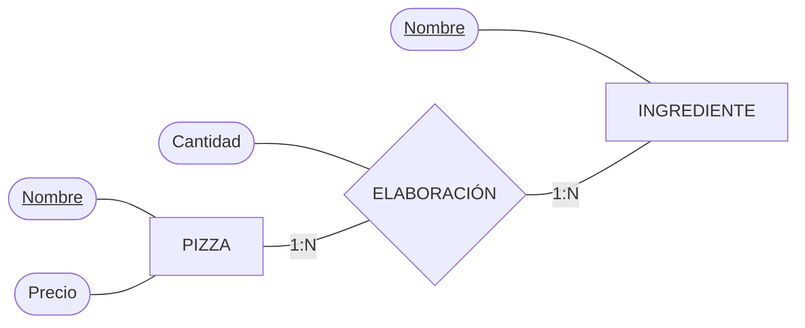

# Ejercicios guiados: diseño del modelo Entidad-Relación (MER)


---

## Metodología de trabajo

Antes de empezar, recordamos el método de para pasar de un enunciado en lenguaje natural a
un diagrama entidad-relación:

| Paso | Qué buscamos en el enunciado |
| :---: | :--- |
| 1. Entidades | Sustantivos que representan "objetos" sobre los que queremos guardar información y que tienen existencia propia (no dependen de otro para identificarse). |
| 2. Atributos y claves | Características de cada entidad; de entre ellas, la que identifica sin ambigüedad a cada ocurrencia (clave primaria, se representa subrayada). |
| 3. Relaciones y cardinalidades | Verbos que conectan dos entidades; para cada relación, cuántas ocurrencias de una entidad se asocian con cuántas de la otra (1:1, 1:N, N:M). |
| 4. Diagrama | Se dibuja con rectángulos (entidades), rombos (relaciones) y óvalos (atributos), uniendo con líneas etiquetadas con la cardinalidad. |

!!! tip "Pista para detectar relaciones N:M"
    Cuando una relación N:M tiene, además, un atributo propio que no pertenece ni a una entidad ni a
    la otra (por ejemplo, una cantidad, una fecha o un importe que solo tiene sentido para esa pareja
    concreta de ocurrencias), ese atributo se cuelga de la **relación**, no de ninguna de las dos
    entidades. Es el caso de los tres ejercicios siguientes.

---

## Ejercicio guiado 1 — Pizzería (examen GVA 2004)

**Enunciado.** Se desea diseñar la base de datos de una pizzería. De cada **pizza** interesa
conocer su nombre, que la identifica sin ambigüedad, y su precio. Cada pizza se elabora con una
serie de **ingredientes** (identificados por su nombre); un mismo ingrediente se usa en muchas
pizzas distintas, y una pizza lleva muchos ingredientes. De cada ingrediente utilizado en una
pizza concreta interesa saber, además, la cantidad (en gramos) empleada — se supone que la masa
se considera un ingrediente más.

Diseña el modelo entidad-relación correspondiente.

### Paso 1. Identificar entidades

Buscamos sustantivos con existencia propia: el enunciado habla de **pizzas** y de **ingredientes**.
Ambos son candidatos claros a entidad: existen y se identifican por sí mismos, con independencia de
que se relacionen entre ellos o no.

- `PIZZA`
- `INGREDIENTE`

### Paso 2. Atributos y claves

- `PIZZA`: **Nombre** (clave: identifica a la pizza sin ambigüedad), **Precio**.
- `INGREDIENTE`: **Nombre** (clave: identifica al ingrediente).

### Paso 3. Relaciones y cardinalidades

El verbo que conecta ambas entidades es "elaborar" (una pizza *se elabora con* ingredientes). El
propio enunciado dice que una pizza lleva varios ingredientes **y** que un ingrediente se usa en
varias pizzas: es, por tanto, una relación **N:M**.

Además, la "cantidad en gramos" no es una característica de la pizza en sí (una misma pizza no
tiene "una cantidad"), ni del ingrediente en sí (el mismo ingrediente pesa distinto según en qué
pizza se use): es un dato que **solo tiene sentido para cada pareja (pizza, ingrediente)**. Por
la pista anterior, ese atributo cuelga de la relación, a la que llamamos `ELABORACION`.

### Paso 4. Diagrama



### Comprobación: del modelo a las tablas

Al traducir este modelo al esquema relacional (fase de diseño lógico, ver UD3), cada entidad se
convierte en una tabla con su clave, y la relación N:M se convierte en una tabla propia cuya clave
es la unión de las claves de las dos entidades que conecta — exactamente las tablas del examen real
de 2004 que ya conoces de *Ejercicios → Consultas SQL*:

- **PIZZAS** (<u>NPizza</u>, Precio)
- **ELABORACIÓN** (<u>NPizza, Ingrediente</u>, Cantidad)

Si el modelo conceptual está bien construido, el esquema relacional "sale solo": no hay ninguna
decisión de diseño en las tablas que no estuviera ya en el diagrama.

---

## Ejercicio 2 — Sistema hidrográfico nacional (examen GVA 2005)

**Enunciado.** Se desea diseñar la base de datos del sistema de gestión hidrográfica nacional.
Cada **río** pertenece administrativamente a una única **cuenca hidrográfica**, de la que interesa
solo su nombre (no se gestiona como entidad aparte). Un río, a lo largo de su curso, puede discurrir
por varias **comunidades autónomas**; y una comunidad autónoma, lógicamente, es atravesada por
varios ríos. De cada río, dentro de cada comunidad por la que pasa, interesa conocer cuántos
kilómetros discurre por ella.

Diseña el modelo entidad-relación correspondiente.

??? success "Solución guiada"
    **Paso 1. Entidades.** `RIO` y `COMUNIDAD` son los dos sustantivos con existencia propia. La
    "cuenca hidrográfica" **no** se convierte en entidad: el enunciado solo pide su nombre como dato
    del río, no necesita gestionarse con sus propios atributos ni relacionarse con otras entidades.

    **Paso 2. Atributos y claves.**

    - `RIO`: **Nombre** (clave), **CuencaHid** (atributo propio del río, no una entidad aparte).
    - `COMUNIDAD`: **Nombre** (clave).

    **Paso 3. Relaciones y cardinalidades.** "Discurre por": un río pasa por varias comunidades y
    una comunidad es atravesada por varios ríos → relación **N:M**, a la que llamamos
    `DISCURRE_POR`. La longitud en km es un dato que depende de la pareja concreta (río, comunidad),
    así que es un atributo de la relación, no de ninguna de las dos entidades.

    **Paso 4. Diagrama.**

    ```mermaid
    flowchart LR
        RIO["RIO"]
        COM["COMUNIDAD"]
        DISC{"DISCURRE_POR"}

        rNombre(["<u>Nombre</u>"]) --- RIO
        cuenca(["CuencaHid"]) --- RIO
        cNombre(["<u>Nombre</u>"]) --- COM
        longitud(["Longitud"]) --- DISC

        RIO ---|"1:N"| DISC
        DISC ---|"1:N"| COM
    ```

    **Comprobación.** Las tablas resultantes son las del examen real de 2005:

    - **RÍOS** (<u>Río</u>, CuencaHid)
    - **RÍOS_COM** (<u>Río, Comunidad</u>, Longitud)

---

## Ejercicio 3 — Laboratorio farmacéutico (examen GVA 2009)

**Enunciado.** Un laboratorio farmacéutico elabora **fórmulas magistrales**. De cada fórmula
interesa su nombre, que la identifica, su periodo máximo de caducidad (en días) y su importe en
euros. Cada fórmula se obtiene mezclando varios **componentes**, identificados por su nombre; un
mismo componente se usa en la elaboración de varias fórmulas distintas. De cada componente, dentro
de cada fórmula en la que se usa, interesa la cantidad necesaria, en mililitros.

Diseña el modelo entidad-relación correspondiente.

??? success "Solución guiada"
    **Paso 1. Entidades.** `FORMULA` y `COMPONENTE`.

    **Paso 2. Atributos y claves.**

    - `FORMULA`: **Nombre** (clave), **Caducidad**, **Importe**.
    - `COMPONENTE`: **Nombre** (clave).

    **Paso 3. Relaciones y cardinalidades.** "Se obtiene mezclando": una fórmula lleva varios
    componentes y un componente se usa en varias fórmulas → relación **N:M**, `COMPOSICION`. La
    cantidad en mililitros solo tiene sentido para cada pareja (fórmula, componente), así que cuelga
    de la relación.

    **Paso 4. Diagrama.**

    ```mermaid
    flowchart LR
        FORM["FORMULA"]
        COMP["COMPONENTE"]
        COMPOS{"COMPOSICIÓN"}

        fNombre(["<u>Nombre</u>"]) --- FORM
        caducidad(["Caducidad"]) --- FORM
        importe(["Importe"]) --- FORM
        cNombre(["<u>Nombre</u>"]) --- COMP
        cantidad(["Cantidad"]) --- COMPOS

        FORM ---|"1:N"| COMPOS
        COMPOS ---|"1:N"| COMP
    ```

    **Comprobación.** Las tablas resultantes son las del examen real de 2009:

    - **FORMULA** (<u>Nom_Formula</u>, caducidad, importe)
    - **COMPOSICION** (<u>Nom_Formula, componente</u>, cantidad)

