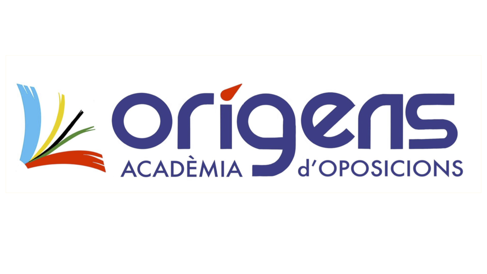

---
hide:
  - navigation
  - toc
---

# Acadèmia Orígens. Especialidad Informática

Bienvenido/a al curso de *L'Acadèmia Orígens* de la especialidad de *Informática*.

Aquí se incluyen ejemplos de ejercicios típicos de exámenes prácticos, así como una variedad de documentación técnica que sirve como repaso para afrontar las pruebas.

{: width="400" }